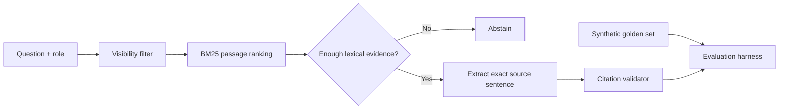

# RAG Quality & Evaluation Lab

[](https://github.com/abedk21/rag-quality-evaluation-lab/actions/workflows/ci.yml)

A **fully offline, reproducible retrieval-augmented generation (RAG) evaluation workbench** built with Python's standard library. It demonstrates retrieval ranking, document-level access control, citation grounding, meaningful abstention, and a small golden-set evaluation suite.

> **Honest scope:** this is an **extractive RAG baseline**, not an LLM chatbot, semantic vector search, Google ADK implementation, or production system. No private company/customer documents, live Google services, API keys, or user credentials are involved.

## Architecture



### Demonstrated engineering skills

- **Document ingestion:** stable passage IDs derived from document IDs and paragraph indices.
- **Retrieval:** transparent lexical BM25 ranking with query-term coverage threshold. This is intentionally interpretable and easy to benchmark.
- **Access control:** public vs. support-only passages filtered *before* ranking, preventing accidental retrieval of restricted content.
- **Answer generation:** verbatim extraction from accessible source paragraphs; no free-form facts invented.
- **Source integrity:** cited passage must exist, be visible to the caller, and include the extracted answer.
- **Abstention:** unknown topics and queries about inaccessible-only content return insufficient evidence.
- **Evaluation:** recall@3, mean reciprocal rank (MRR), abstention accuracy, and verbatim citation validation on a checked-in synthetic golden set.
- **Adversarial fixture:** synthetic prompt-injection text is treated as *data*, not executable instructions.

## Run locally

**Python 3.11+; no packages or API keys required.**

```bash
python cli.py --query "Why does an agent tool call fail with 403 missing OAuth scope?"
python cli.py --query "What belongs in an internal escalation?" --role support
python cli.py --query "What belongs in an internal escalation?" --role public
python cli.py --evaluate
python -m unittest discover -s tests -v
```

The `--role support` option is **only a local simulation of an authorization context**, not authentication. Don't deploy a public API that accepts a user-controlled role string as authorization.

## Reproduce the evaluation

`data/documents.json` includes fictional passages on OAuth, GenAI quotas, RAG grounding, tool-call tracing, Kubernetes readiness, and a support-only escalation runbook. `data/golden.json` includes eight synthetic questions, including unknown and access-restricted cases.

The evaluator reports:

| Metric | What is being measured |
| --- | --- |
| recall@3 | Whether the expected source document appears among the top three retrieved passages |
| MRR | Reciprocal rank of the first correct document, averaged over answerable questions |
| abstention accuracy | Whether answerable vs. unanswerable questions are correctly identified |
| citation validity | Whether the extractive answer appears verbatim in an authorized cited passage |

The small test dataset was intentionally written for this baseline. **Perfect scores here do not indicate production accuracy**, semantic understanding, resistance to sophisticated prompt injection, or generalization to real enterprise corpora.

## Known limitations / future extensions

- No embeddings, multimodal retrieval, answer generation by a model, or live Vertex AI services.
- Paragraph-level passages; no file parsing, dynamic chunk selection or scalable index.
- For a production service, enforce authorization using verified identity claims and server-side permissions rather than the demo CLI role.
- Candidate next iterations: **Google Gemini API** behind an opt-in provider adapter, Vertex AI embeddings, grounded output evaluation with human judgments, semantic retrieval comparisons, latency and token-cost analysis, and OpenTelemetry instrumentation.

## Privacy & security

Use only the checked-in synthetic dataset. Do not replace these files with customer logs or internal support content. No outbound requests are made.

Licensed under the MIT License; see [LICENSE](LICENSE).
